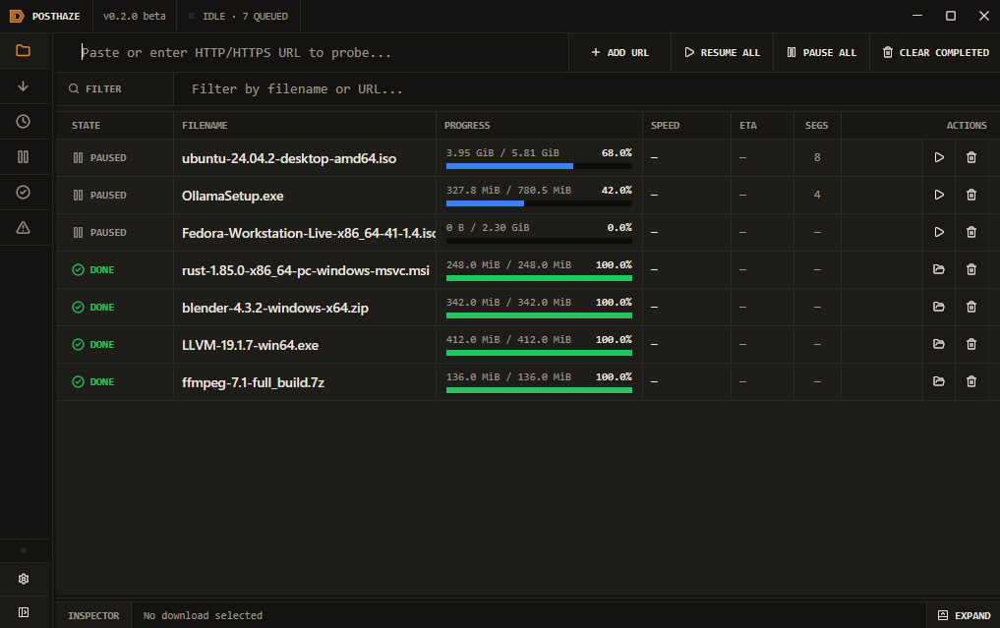
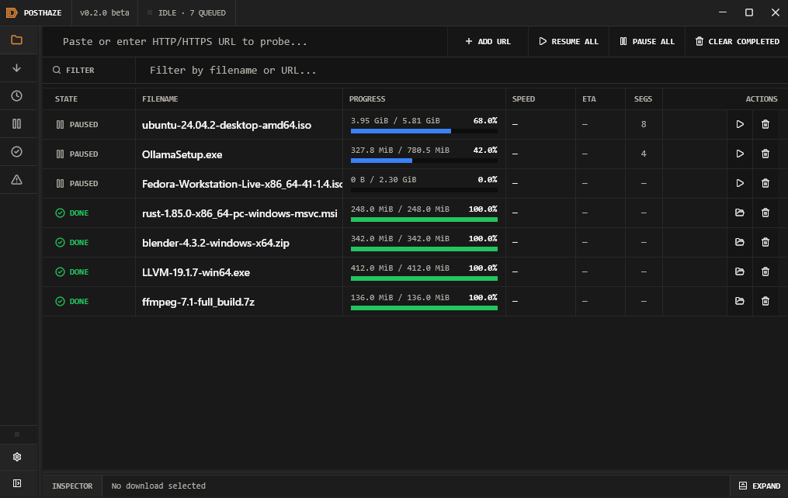
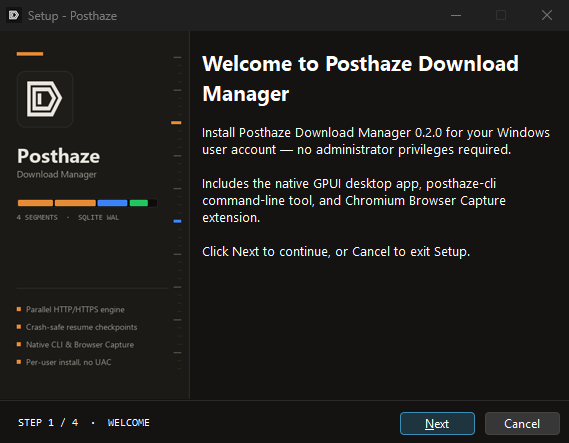
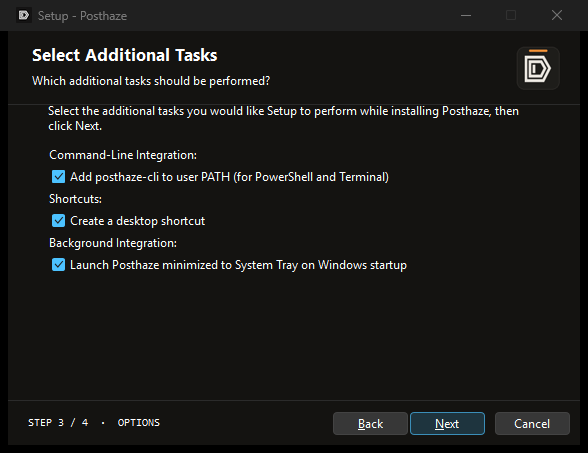

<div align="center">


<br />
<br />

**A fast, lightweight Windows 10/11 download manager built in Rust.**  
Multi-connection acceleration, crash-safe resume, native Windows 11 Mica themes, and one-click Chrome/Edge/Brave browser capture—without Electron bloat.

<p>
  <a href="https://github.com/prag-matic/posthaze-download-manager/releases/latest"></a>
  <a href="https://github.com/prag-matic/posthaze-download-manager/actions/workflows/ci.yml"></a>
  <a href="https://github.com/prag-matic/posthaze-download-manager/releases/latest"></a>
  <a href="LICENSE"></a>
</p>

[**Download**](https://github.com/prag-matic/posthaze-download-manager/releases/latest) · [**Features**](#features) · [**Browser Extension**](#browser-extension-chrome--edge--brave) · [**Benchmarks**](#benchmarks) · [**Technical Details**](#technical-details--build-from-source) · [**Docs**](docs/README.md)

</div>

---

<p align="center">
  <picture>
    <source media="(prefers-color-scheme: dark)" srcset="docs/screenshots/posthaze-chronophotographic.png">
    <source media="(prefers-color-scheme: light)" srcset="docs/screenshots/posthaze-archival-light.png">
    
  </picture>
</p>

<details>
<summary><b>More screenshots (Windows 11 Mica Dark &amp; Windows 11 Installer)</b></summary>

<br />

**Windows 11 Mica Dark**


**Windows 11 Installer (adapts to Windows Light & Dark mode)**
<p align="center">
  
  
</p>

</details>

---

## Features

- **Faster downloads automatically:** Splits files across parallel connections and dynamically reassigns idle workers to finish slow segments (**3.17× faster** than static splitting in real-world tests).
- **Crash-safe pause & resume:** Progress is saved continuously to a local SQLite database. Pause anytime, reboot, or recover from dropped connections without losing downloaded data.
- **Native Windows feel, tiny footprint:** Pure Rust and GPU-accelerated GPUI—uses **~86 MiB RAM** and **0% CPU** when minimized to the System Tray, even with 500 downloads in your queue.
- **Browser capture for Chrome, Edge & Brave:** Send downloads and right-click links—along with login cookies, referrers, and headers—straight into Posthaze.
- **8 built-in themes + Windows 11 Mica:** Includes **Mica (System)**, **Mica Dark**, **Mica Light**, and 5 opaque themes (with automatic fallback on Windows 10).
- **Power-user controls:** Speed limits, HTTP/HTTPS/SOCKS5 proxies, custom headers, **Paste as cURL**, FIFO queues, **Verify Checksum** integrity checks, Recycle Bin support, native Windows notifications, System Tray mode, and a full CLI (`posthaze-cli`).
- **Verified auto-updates:** Checks GitHub Releases and verifies every installer with both **Ed25519** signatures and **SHA-256** checksums before upgrading.

---

## Quick Install

Grab the latest build from [**GitHub Releases**](https://github.com/prag-matic/posthaze-download-manager/releases/latest) (Windows 10 1809+ or Windows 11, 64-bit):

| Option | File | Best For |
|---|---|---|
| **Windows Installer** | `posthaze-*-windows-x64-setup.exe` | Most users. Per-user install (no admin needed), Start Menu shortcuts, adds `posthaze-cli` to `PATH`, bundles the browser extension, and supports one-click auto-updates. |
| **Portable ZIP** | `posthaze-*-windows-x64-portable.zip` | USB drives or zero-install setups. Extract and run anywhere—keeps all database files and logs inside `./data/`. |

> [!NOTE]
> **Windows SmartScreen:** Release binaries do not currently use a paid Authenticode certificate. If Windows SmartScreen warns you on first run, check the file hash against `SHA256SUMS.txt` on the release page, then click **More info → Run anyway**:
> ```powershell
> Get-FileHash .\posthaze-0.2.3-windows-x64-setup.exe -Algorithm SHA256
> ```

---

## Browser Extension (Chrome / Edge / Brave)

Posthaze ships with a Manifest V3 extension in `extensions/chrome/` (bundled inside the Windows Installer at `%LOCALAPPDATA%\Programs\Posthaze\extensions\chrome` and inside the Portable ZIP).

1. Open `chrome://extensions` (or `edge://extensions` / `brave://extensions`).
2. Turn on **Developer mode**, click **Load unpacked**, and pick the `extensions/chrome/` folder (pinned to deterministic Extension ID `eiophahfcjidkfgdddgejjglglaopahi`).
3. Open **Posthaze → Settings → Integrations** and click **REGISTER NATIVE HOST** (the Extension ID is pre-filled automatically).
4. Click the **Posthaze** icon in your browser toolbar and make sure the status badge shows **UI ONLINE** or **HOST READY**.

*(Full setup details, capture filters, and CLI fallback: [`extensions/chrome/README.md`](extensions/chrome/README.md).)*

---

## Benchmarks

Measured on Windows 11 Pro (Intel Core i5-11320H, 16 GiB RAM, NVMe SSD) using release builds. Full tables and methodology live in [`docs/benchmarks/`](docs/benchmarks/ram-and-performance-optimization.md).

| Metric | Measured Result | Source |
|---|---|---|
| **Real-world work-stealing speedup** (`115.46 MiB` GitHub MSI, 8 connections) | **3.17× faster** (`38.35 s` → **`12.08 s`**, `80.17 Mbps` avg; `192.51 Mbps` peak at 32 conn) | [Work-Stealing Benchmark](docs/benchmarks/ticket-04-work-stealing.md) |
| **Sustained multi-Gbps loopback** (`1 GiB` transfer, `16 MiB` bounded writer buffer) | **`1.8–4.2 Gbps`** medians (peaks up to **`7.0–7.36 Gbps`**) | [RAM & Perf Results](docs/benchmarks/ram-and-performance-optimization.md) |
| **SQLite WAL checkpoint overhead** (`posthaze` vs. `posthaze (db)`) | **~0–5%** (within loopback variance) | [SQLite Checkpoint Benchmark](docs/benchmarks/milestone-02-sqlite-checkpoint-overhead.md) |
| **Memory — Cold Idle (Tray / Visible)** | **`85.76 MiB`** (Tray) / **`97.13 MiB`** (Visible) Working Set | [RAM & Perf Results](docs/benchmarks/ram-and-performance-optimization.md) |
| **Memory & CPU — 500 Downloads in Queue (Tray)** | **`86.73 MiB`** (`+0.97 MiB` delta) & **`0.0000 s` CPU** over 10 s | [RAM & Perf Results](docs/benchmarks/ram-and-performance-optimization.md) |

---

## Technical Details & Build From Source

<details>
<summary><b>Architecture, workspace crates, and CLI usage</b></summary>

### Workspace Structure (Rust Edition 2024)

| Crate | Purpose |
|---|---|
| `crates/posthaze-engine` | Decoupled HTTP/HTTPS multi-connection engine, adaptive work-stealing scheduler, positional disk writer, SQLite WAL persistence, BLAKE3 hashing |
| `crates/posthaze-ui` | Native Windows 10/11 GPUI + GPUI Kit desktop app, System Tray, Win32 DWM Mica themes, Ed25519 + SHA-256 auto-updater |
| `crates/posthaze-cli` | Headless CLI (`download`, `list`, `resume`, `cancel`, `delete`, `bench`) and Chromium Native Messaging Host |
| `crates/posthaze-keytool` | Internal release tool (`publish = false`) for Ed25519 signing and signature verification |

### Stack Overview
- **Engine & Async:** Tokio (bounded worker & blocking pools), `reqwest` (`rustls-tls`), `bytes` recycled chunk pool
- **Storage:** SQLite via `sqlx` (WAL mode, `synchronous = NORMAL`, automatic idle memory shrink)
- **Desktop UI:** GPUI + `gpui-kit`, `tray-icon`, Win32 DWM (`windows-sys`)
- **Security & Integrity:** `ed25519-dalek` + `sha2` (auto-updater verification), `blake3` (file integrity), per-user Inno Setup 6.7+ installer

### Build & Run From Source

```powershell
# Run full test suite
cargo test --workspace

# Launch the desktop UI (release)
cargo run --release -p posthaze-ui

# Use the headless CLI
cargo run --release -p posthaze-cli -- download "<URL>"
cargo run --release -p posthaze-cli -- list
cargo run --release -p posthaze-cli -- resume <DOWNLOAD_ID>
cargo run --release -p posthaze-cli -- bench --sizes 100M -c 1,4,8,16 --runs 3
```

</details>

---

## Documentation

- [Documentation Index](docs/README.md) — Architecture, milestones, ADRs, and API docs
- [Auto-Updater & Signature Verification](docs/auto-updater.md) — Ed25519 + SHA-256 upgrades and portable mode
- [Release Packaging & Portable Mode](docs/release-packaging-and-portable-mode.md) — Windows installer, `posthaze.portable`, System Tray, and logs
- [Creating Themes](docs/creating-themes.md) — 8 built-in themes (including Windows 11 Mica) and palette tokens
- [Settings, Custom Headers & Context Menu](docs/settings-and-context-menu.md) — 9-tab Settings, proxies, throttling, and Paste as cURL
- [Benchmarking & Stress-Testing Guide](docs/benchmarking.md) — How to reproduce throughput and memory results
- [Changelog](CHANGELOG.md) — Release history

---

## Credits

Posthaze is built on top of these open-source projects:

- **UI & Windows Integration:** [GPUI](https://www.gpui.rs/) (Zed Industries), [gpui-kit](https://crates.io/crates/gpui-kit), [tray-icon](https://crates.io/crates/tray-icon), [windows-sys](https://crates.io/crates/windows-sys), [image](https://crates.io/crates/image), [tauri-winres](https://crates.io/crates/tauri-winres)
- **Networking & Async Runtime:** [Tokio](https://tokio.rs/), [reqwest](https://crates.io/crates/reqwest) + [rustls](https://github.com/rustls/rustls), [futures-util](https://crates.io/crates/futures-util), [bytes](https://crates.io/crates/bytes)
- **Storage & Data:** [SQLx](https://crates.io/crates/sqlx) (SQLite), [Serde](https://serde.rs/), [uuid](https://crates.io/crates/uuid), [semver](https://crates.io/crates/semver)
- **Cryptography & Integrity:** [BLAKE3](https://github.com/BLAKE3-team/BLAKE3), [ed25519-dalek](https://crates.io/crates/ed25519-dalek), [sha2](https://crates.io/crates/sha2)
- **CLI, Diagnostics & Packaging:** [clap](https://crates.io/crates/clap), [tracing](https://crates.io/crates/tracing), [thiserror](https://crates.io/crates/thiserror), [Criterion.rs](https://crates.io/crates/criterion), [Inno Setup](https://jrsoftware.org/isinfo.php)

---

## Contributing & License

- **Contributing:** Bug reports, feature requests, and pull requests are welcome. Before opening a PR, please review [`docs/CODING_STANDARDS.md`](docs/CODING_STANDARDS.md) and run `cargo test --workspace`, `cargo clippy --workspace --all-targets -- -D warnings`, `cargo doc --workspace --no-deps`, and `./scripts/check-repo.ps1`.
- **License:** Released under the [MIT License](LICENSE).
