**Platform:** Windows 10/11 · **Stack:** Rust + Slint

The goal is to build a Windows-native download manager capable of competing with Internet Download Manager (IDM), not just a desktop application that downloads files.

The design is a high-performance, asynchronous, multi-connection download engine written entirely in Rust, with a separate desktop interface built in Slint.

The most important architectural decision is to make the **download engine independent of the user interface**. The engine must be able to run benchmarks, automated tests, and headless downloads without launching the desktop application.

---

## 1. Product vision

**Working project name:** Velocity Download Manager (VDM) — a high-performance Windows download manager.

### Product objectives

- Maximize sustainable download throughput.
- Efficiently utilize available network bandwidth.
- Support segmented downloading and intelligent concurrency.
- Provide reliable pause, resume, and recovery.
- Minimize CPU and RAM consumption.
- Deliver a polished Windows desktop experience.

### Initial product scope

|Area|Initial scope|
|---|---|
|Operating system|Windows 10/11 x64|
|Download protocols|HTTP / HTTPS|
|Download engine|Rust|
|Concurrency|Async multi-connection|
|Segmentation|HTTP Range Requests|
|Persistence|SQLite|
|Desktop UI|Slint|
|UI markup|`.slint` (declarative) with Rust glue code|
|Build system|Cargo|
|Distribution|Windows installer|

> **Non-goals for the initial release:** BitTorrent, video extraction, FTP/SFTP, browser extensions, and cloud synchronization. These can be added after the HTTP engine is stable, and the architecture should provide a foundation for future browser integration and advanced protocols.

---

## 2. High-level system architecture

A **modular monolith** is recommended rather than microservices. There is no need for multiple network services or independently deployed components in a single-user desktop application. Modular boundaries provide the separation needed without unnecessary operational complexity.

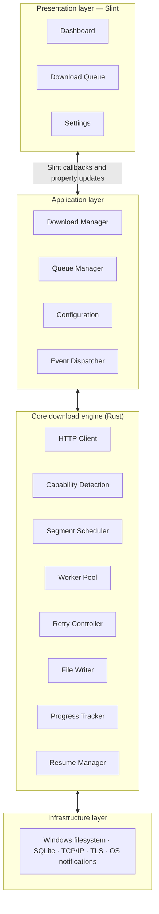

### Architectural boundaries

|Component|Responsibility|
|---|---|
|Frontend (Slint)|Rendering and user interactions|
|Application layer|Download lifecycle and queue management|
|Download engine|HTTP requests, segments, workers|
|Storage layer|File writes and persistence|
|Infrastructure|Windows-specific functionality|

**The UI must never directly manage HTTP connections or file segments.**

---

## 3. Technology selection

These are the libraries recommended for evaluation, pinned to tested versions.

|Technology|Library|Purpose|
|---|---|---|
|Language|Rust|Main application|
|Async runtime|Tokio|Async task execution|
|HTTP client|reqwest|HTTP/HTTPS|
|HTTP internals|Hyper|Advanced HTTP control if needed|
|Serialization|Serde|Data serialization|
|Database|SQLx|Async SQLite access|
|Desktop|Slint|Native desktop shell|
|UI markup|`.slint`|Declarative UI definitions|
|Hashing|BLAKE3|Fast file hashing|
|Logging|tracing|Diagnostics|
|Errors|thiserror|Typed library errors|
|CLI|clap|Headless benchmark interface|

> **Important implementation choice:** Start with reqwest. It already uses Hyper and Tokio. Do not write a custom HTTP stack or introduce Hyper directly unless profiling demonstrates a real limitation or you need lower-level protocol control.

---

## 4. Repository and project structure

Use a Cargo workspace to separate the engine, application logic, Windows integration, and desktop shell. A monorepo is recommended.

```text
velocity/
│
├── apps/
│   ├── desktop/                  # Slint desktop application
│   │   ├── src/
│   │   │   ├── main.rs
│   │   │   ├── callbacks/        # Slint callback handlers (UI -> app layer)
│   │   │   ├── events/           # Engine events -> UI property updates
│   │   │   ├── state.rs
│   │   │   └── lib.rs
│   │   ├── ui/
│   │   │   ├── app-window.slint
│   │   │   ├── components/
│   │   │   ├── screens/
│   │   │   └── theme/
│   │   ├── build.rs              # Compiles .slint files
│   │   └── Cargo.toml
│   │
│   └── cli/                      # Headless testing interface
│       └── src/main.rs
│
├── crates/
│   ├── download-core/            # Core download orchestration
│   ├── download-protocol/        # HTTP/HTTPS operations
│   ├── download-scheduler/       # Segment scheduling
│   ├── download-storage/         # File operations
│   ├── download-persistence/     # SQLite repositories
│   ├── download-queue/           # Queue and concurrency
│   ├── download-events/          # Progress/event models
│   ├── download-config/          # Configuration
│   ├── download-integrity/       # Hash verification
│   └── windows-integration/      # Windows-specific APIs
│
├── benchmarks/
│   ├── scenarios/
│   ├── fixtures/
│   └── reports/
│
├── tests/
│   ├── integration/
│   ├── recovery/
│   ├── network/
│   └── fixtures/
│
├── docs/
│   ├── architecture/
│   ├── decisions/
│   └── benchmarks/
│
├── Cargo.toml
├── Cargo.lock
└── README.md
```

### Responsibilities of each crate

|Crate|Responsibility|
|---|---|
|`download-core`|Coordinates the download lifecycle|
|`download-protocol`|HTTP requests and server detection|
|`download-scheduler`|Splits files and assigns work|
|`download-storage`|Preallocation and positioned writes|
|`download-persistence`|SQLite metadata and recovery|
|`download-queue`|Global and per-download limits|
|`download-events`|Typed events and progress updates|
|`download-config`|User preferences and engine configuration|
|`download-integrity`|Hash verification|
|`windows-integration`|Windows notifications, shell integration and startup|

Each crate should have its own unit tests. Avoid circular dependencies.

### Dependency direction

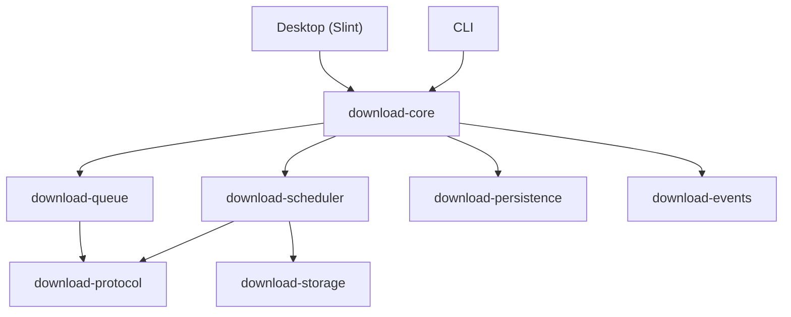

Keep the domain models independent of Slint. The same engine must work from the CLI and the desktop application.

---

## 5. Download engine architecture

This is the most important subsystem. Implement the engine as a **state-driven download pipeline**.

### 5.1 Download lifecycle

A download should follow a clearly defined state machine.

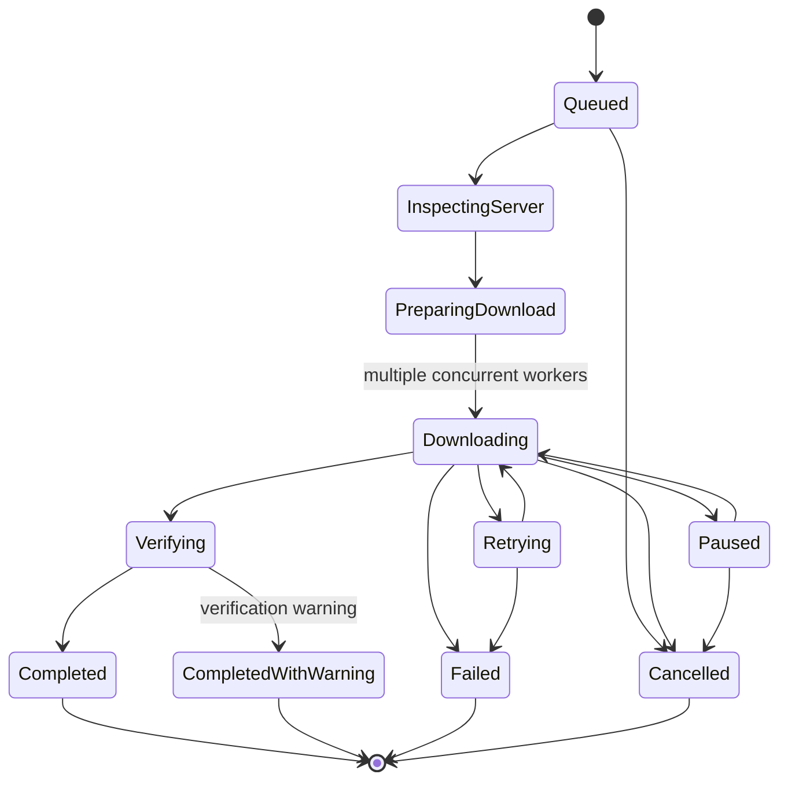

Additional terminal states:

- Failed
- Cancelled
- Completed with verification warning

Pause and retry are transitions, not necessarily terminal states.

Use a state machine that **rejects invalid transitions**. For example, a completed download must not transition back to downloading without an explicit restart operation.

### 5.2 Server capability detection

Before downloading, determine whether the server supports segmented downloading.

Recommended inspection sequence:

1. Send a `HEAD` request.
2. Read `Content-Length`.
3. Read `Accept-Ranges`.
4. Record `ETag` and `Last-Modified`.
5. If `HEAD` is unsupported or inconclusive, try a small `GET` with `Range: bytes=0-0`.
6. Validate the response.

Example:

```http
GET /large-file.zip HTTP/1.1
Host: example.com
Range: bytes=0-0
```

Expected response:

```http
HTTP/1.1 206 Partial Content
Content-Range: bytes 0-0/1000000000
Content-Length: 1
```

> A server advertising `Accept-Ranges` is not sufficient proof. **Validate actual range behavior.**

Capability detection results:

```rust
struct RemoteFileInfo {
    total_size: Option<u64>,
    supports_ranges: bool,
    etag: Option<String>,
    last_modified: Option<String>,
    filename: Option<String>,
}
```

If the server doesn't support range requests, use a sequential download.

### 5.3 Segment scheduling strategy

A hybrid strategy is recommended: **fixed-size segments + dynamic worker scheduling.**

Instead of assigning one large file section permanently to each connection, divide the file into smaller chunks and let workers request available chunks from a shared queue. Workers claim chunks dynamically, avoiding permanent assignment of slow chunks to individual connections.

**Example: 1 GB file** (illustrative 64 MiB chunks, with a smaller final chunk)

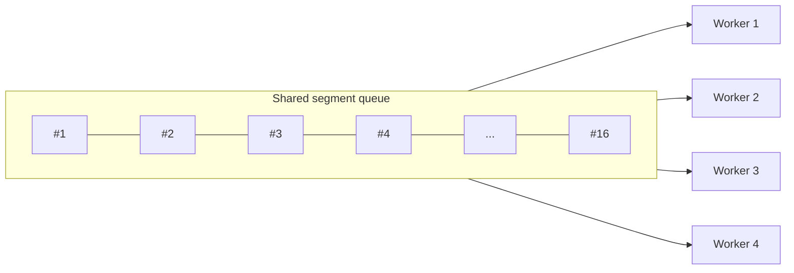

The scheduler should support:

- Pending segment queue.
- Active segment tracking.
- Completed segment tracking.
- Failed segment retry queue.
- Worker availability.
- Cancellation and pause signals.

A segment model:

```rust
struct Segment {
    id: u32,
    start: u64,
    end: u64,
    downloaded: u64,
    status: SegmentStatus,
}

enum SegmentStatus {
    Pending,
    Downloading,
    Completed,
    Failed,
}
```

> **A crucial detail:** `downloaded` must represent **successfully written bytes**, not merely bytes received from the network.

### Recommended starting configuration

These are initial experimental settings, not universal optimal values. Make them configurable for benchmarking.

|Setting|Starting value|
|---|---|
|Initial connections per file|4|
|Maximum connections per file|16|
|Initial chunk size|16 MiB|
|Small-file threshold|8 MiB|
|Maximum active downloads|3|
|Maximum global connections|32|
|Progress reporting|4 times/second|

---

## 6. Concurrency architecture

Tokio should manage asynchronous network operations. **Do not create an operating-system thread for every segment.**

### 6.1 Concurrency model

There are three distinct levels of concurrency:

1. **Download-level:** multiple files downloading simultaneously.
2. **Worker-level:** multiple connections for one file.
3. **I/O-level:** reading network data and writing to disk.

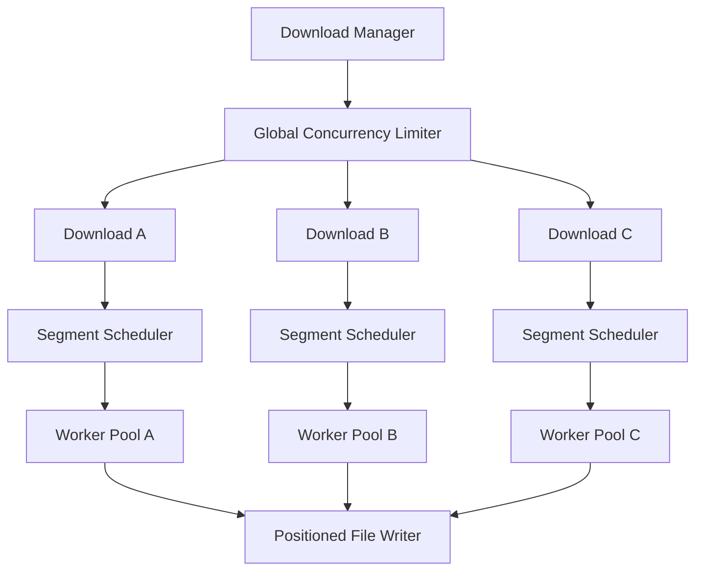

### Worker implementation approach

Each worker should:

1. Acquire a global connection permit.
2. Claim a pending segment.
3. Send an HTTP Range request.
4. Validate HTTP status and range metadata.
5. Stream the response body in bounded chunks.
6. Write to the corresponding file offset.
7. Update progress.
8. Mark the segment complete.
9. Release the permit.

Conceptually:

```rust
async fn worker(
    scheduler: SegmentScheduler,
    client: reqwest::Client,
    writer: FileWriter,
    cancellation: CancellationToken,
) {
    loop {
        if cancellation.is_cancelled() {
            break;
        }

        let Some(segment) = scheduler.claim().await else {
            break;
        };

        // Download segment.
        // Validate response.
        // Stream bytes.
        // Write at the correct offset.
        // Report progress.
        // Commit segment completion.
    }
}
```

This is architectural pseudocode; actual implementation needs explicit error propagation and segment requeue handling.

### Why bounded concurrency matters

If you create thousands of concurrent requests, you can:

- Exhaust available sockets.
- Increase memory usage.
- Overload the server.
- Cause congestion and throttling.
- Reduce overall throughput.

Use Tokio semaphores or an equivalent admission controller to enforce limits.

### 6.2 Adaptive concurrency

Once the initial engine is stable, introduce adaptive connection management. Start with four connections and measure performance over a time window.

An illustrative policy:

|Observation|Action|
|---|---|
|Throughput improves consistently|Increase concurrency|
|Throughput remains unchanged|Stop increasing|
|HTTP 429 or throttling|Reduce concurrency and back off|
|Repeated connection errors|Reduce concurrency|
|Disk writes become saturated|Avoid increasing network workers|

Use an **AIMD-style controller**:

- Add one connection after sustained improvement.
- Multiplicatively reduce connections when congestion or throttling is detected.
- Apply a cooldown before increasing again.

> Don't use short-term speed fluctuations as the only signal. Network throughput is noisy.

---

## 7. Efficient file I/O architecture

This is where many download managers lose performance. You need to write data directly to its correct location in the output file **without buffering entire segments in RAM**.

### Recommended approach

Use **preallocation and positioned writes**. For example:

```text
File: example.zip
Total size: 1 GB

Worker 1 -> Offset 0
Worker 2 -> Offset 64 MB
Worker 3 -> Offset 128 MB
Worker 4 -> Offset 192 MB
```

On Windows, evaluate `std::os::windows::fs::FileExt::seek_write` for positioned writes. Benchmark it against alternative implementations.

Possible implementations:

|Method|Consideration|
|---|---|
|Shared async file with mutex|Simple, but writes serialize|
|Dedicated writer task|Good ownership and backpressure|
|Windows positioned writes|Avoid shared seek-position races|
|Memory-mapped file|Advanced option; requires careful page and durability management|

Initially implement a dedicated writer abstraction, then benchmark positioned writes before committing to a lower-level Windows-specific implementation.

### File safety

Never write directly to the final destination during an incomplete download. Use:

```text
example.zip.part
```

After all segments complete:

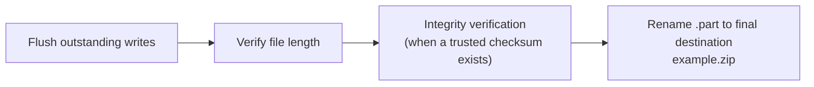

For durability, checkpoint completed segments and flush according to a configurable policy. **A checkpoint must never claim that data is durable when it is only in an application buffer.**

---

## 8. Resume and persistence architecture

This is essential for competing with IDM. Use SQLite for persistent download metadata and a temporary file for the actual data.

### Database schema

```sql
CREATE TABLE downloads (
    id TEXT PRIMARY KEY,
    url TEXT NOT NULL,
    filename TEXT NOT NULL,
    destination TEXT NOT NULL,
    total_size INTEGER,
    downloaded_size INTEGER DEFAULT 0,
    etag TEXT,
    last_modified TEXT,
    status TEXT NOT NULL,
    created_at TEXT NOT NULL,
    updated_at TEXT NOT NULL
);

CREATE TABLE segments (
    id INTEGER PRIMARY KEY AUTOINCREMENT,
    download_id TEXT NOT NULL,
    start_offset INTEGER NOT NULL,
    end_offset INTEGER NOT NULL,
    downloaded_bytes INTEGER DEFAULT 0,
    status TEXT NOT NULL,
    FOREIGN KEY (download_id) REFERENCES downloads(id)
);
```

Add indexes on `segments.download_id` and any frequently queried download state.

### Recovery procedure

When the application starts:

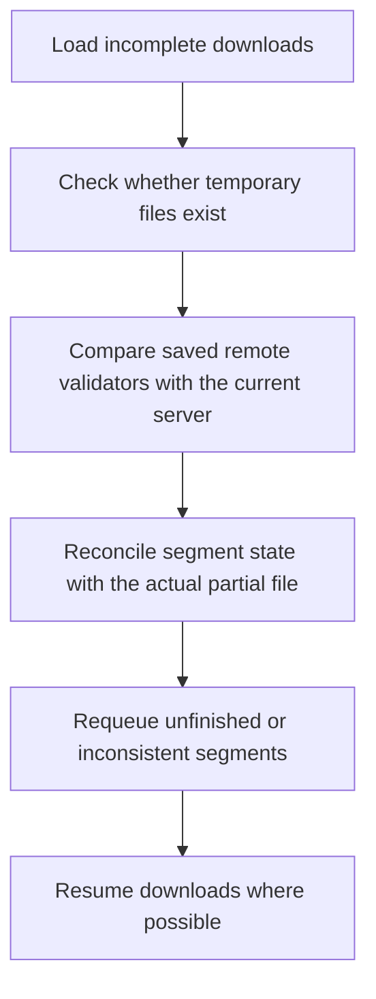

> **Important:** Use `If-Range` with an `ETag` or `Last-Modified` validator when resuming range requests. If the resource changed, do not combine bytes from different versions of the file.

When the server cannot provide reliable validators, resume must be treated more cautiously.

---

## 9. HTTP networking architecture

Use a reusable HTTP client rather than creating a new client for each request.

Recommended features:

- Connection pooling.
- TLS verification.
- Redirect handling.
- Configurable timeouts.
- HTTP/1.1 and HTTP/2 support.
- Streaming response bodies.
- Range request validation.
- Retry and exponential backoff.
- User-Agent configuration.

### Important HTTP edge cases

|Scenario|Required behavior|
|---|---|
|HTTP 200 instead of 206|Do not treat response as a valid segment|
|HTTP 416|Re-evaluate remote file size and range|
|HTTP 429|Respect `Retry-After` where provided|
|HTTP 5xx|Retry with bounded exponential backoff|
|Redirect|Re-evaluate effective URL and resource capabilities|
|Expired signed URL|Report authentication/URL expiry|
|Changed ETag|Discard incompatible partial data|
|Unknown file size|Sequential streaming|
|Connection dropped|Resume incomplete segment safely|

Do not automatically retry every error. A malformed range response or changed remote file requires different handling from a transient network timeout.

---

## 10. Progress tracking and event architecture

The UI needs responsive progress information without creating unnecessary CPU overhead. Separate internal progress updates from UI event publishing.

### Internal progress model

```rust
struct DownloadProgress {
    total_bytes: Option<u64>,
    downloaded_bytes: u64,
    download_speed: f64,
    average_speed: f64,
    active_connections: u32,
    completed_segments: u32,
    total_segments: u32,
    eta_seconds: Option<u64>,
}
```

Calculate:

$$ \text{Speed} = \frac{\text{Bytes downloaded during interval}}{\text{Elapsed seconds}} $$

Use an exponential moving average to smooth the displayed speed:

$$ EMA_t = \alpha X_t + (1-\alpha)EMA_{t-1} $$

For example, use $\alpha = 0.25$ initially and tune it based on the desired responsiveness.

### Event flow

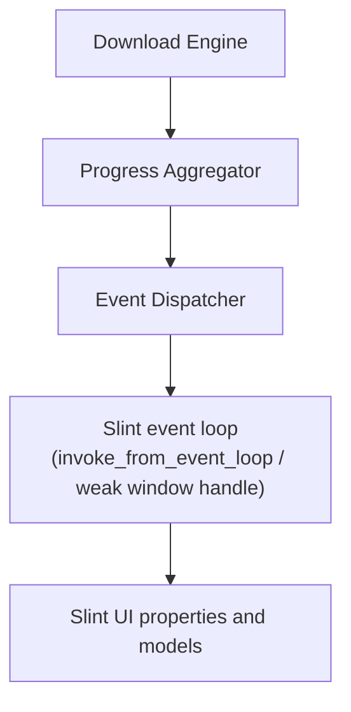

Recommended UI event frequency: **4–10 updates per second**, rather than sending an event for every network buffer.

Events should contain stable download IDs, so the frontend can update the correct row (e.g. via a Slint `VecModel`) without reconstructing the entire download list.

---

## 11. Desktop application architecture

The desktop application should feel like a polished Windows utility rather than a web application inside a window.

### Recommended navigation

1. Downloads
2. Queue
3. Completed
4. Scheduler
5. Settings

### Essential interactions

- Paste URL.
- Drag and drop URLs.
- Pause and resume.
- Cancel and delete.
- Open downloaded file.
- Open containing folder.
- Change download destination.
- Configure connection limits.
- Set global bandwidth limits.

### Slint callback design

Expose a small set of application commands as Slint callbacks, implemented in Rust and forwarded to the application layer:

|Callback|Purpose|
|---|---|
|`add_download`|Create a download|
|`pause_download`|Pause an active download|
|`resume_download`|Resume|
|`cancel_download`|Cancel|
|`remove_download`|Remove a download record|
|`get_downloads`|Get download list|
|`get_download_details`|Get individual details|
|`update_settings`|Change engine settings|

The UI should use callbacks for actions and property/model updates for live data. **Never expose arbitrary filesystem access to the UI layer.** Validate destinations in the application layer before they reach the engine.

---

## 12. Benchmarking and performance engineering

This is where the project should differentiate itself. Do not optimize based on assumptions or subjective impressions. Build a benchmarking environment from the beginning.

### 12.1 What to measure

|Metric|Why it matters|
|---|---|
|Average throughput|Sustained download performance|
|Peak throughput|Maximum observed speed|
|Total download time|Real-world effectiveness|
|CPU utilization|Processing overhead|
|RAM usage|Memory efficiency|
|Disk write throughput|Storage bottlenecks|
|Connection count|Network resource usage|
|Time to first byte|Startup overhead|
|Resume recovery time|Reliability|
|Error rate|Stability|

### 12.2 Benchmark scenarios

**File size benchmarks** (suggested sizes, not measured results; approximate values read from the original chart):

|Class|Approx. size|
|---|---|
|Small|~10 MB|
|Medium|~100 MB|
|Large|~1 GB (≈1,000 MB)|
|Very large|~5 GB (≈5,000 MB)|

**Concurrency benchmarks** — connection counts to test experimentally: `1, 2, 4, 8, 16, 32`.

Additional scenarios:

|Scenario|Purpose|
|---|---|
|Small files (1–10 MB)|Request overhead|
|Large files (1–5 GB)|Sustained throughput|
|Multiple simultaneous files|Global scheduling|
|Slow server|Adaptive concurrency|
|High latency|Connection behavior|
|Interrupted network|Recovery|
|Server throttling|Retry behavior|
|Non-range server|Sequential fallback|
|Disk-limited test|I/O efficiency|

### 12.3 Build a controlled benchmark server

Building a small HTTP test server specifically for this project is strongly recommended. It should support:

- Configurable file sizes.
- HTTP Range requests.
- Artificial network latency.
- Bandwidth throttling.
- Random connection interruptions.
- HTTP 429 and 500 responses.
- ETag changes.
- Optional range-request rejection.

This allows repeatable tests without depending on public download servers. Use a local test server for engine correctness and controlled throughput experiments, then use external servers for real-world validation.

### 12.4 Compare with existing tools

|Tool|Role|
|---|---|
|Internet Download Manager|Commercial Windows benchmark|
|Free Download Manager|Free desktop benchmark|
|aria2|Headless download engine benchmark|

Run each test multiple times under identical conditions. Alternate the order of applications to reduce the effect of changing network conditions.

Do not compare an eight-connection download against a 32-connection download and attribute all differences to implementation quality.

### Performance targets

These are proposed engineering targets, not guarantees.

|Metric|Initial target|
|---|---|
|Network utilization|At least 90% of sustainable test throughput|
|CPU overhead|Low relative to network capacity|
|Idle memory|Under 100 MB for the desktop application|
|Small-file overhead|Minimal startup and scheduling delay|
|Resume reliability|No corrupted or missing acknowledged data|
|UI responsiveness|No noticeable blocking during heavy downloads|
|Progress updates|Smooth 4–10 updates/sec|

A 90% throughput target should only apply when the test server and network can sustain that rate.

### 12.5 Benchmark tools

- `hyperfine` – command execution benchmarking.
- `cargo bench` – Rust benchmarks.
- `criterion` – statistical microbenchmarks.
- Windows Performance Monitor – CPU, memory, disk, network.
- Windows Performance Recorder / Analyzer – deeper profiling.
- `tracing` – internal performance instrumentation.
- `iperf3` – network capacity testing.

Use release builds for performance tests. Debug builds are not representative.

---

## 13. Reliability, security and testing

A download manager handles arbitrary remote servers and local files, so correctness is just as important as speed.

### Security requirements

- HTTPS certificate verification must remain enabled.
- Never execute downloaded files automatically.
- Sanitize filenames from `Content-Disposition`.
- Prevent path traversal and invalid Windows filenames.
- Handle reserved Windows device names.
- Protect against redirects to unsupported schemes.
- Do not log authorization headers or signed URL credentials.
- Apply strict URL and redirect validation.
- Restrict access to temporary files and application data.
- Avoid exposing unrestricted filesystem operations to the UI layer.

### Testing strategy

|Test type|Tool|
|---|---|
|Unit tests|Rust `cargo test`|
|Async tests|Tokio test utilities|
|HTTP integration|Controlled HTTP server|
|Persistence tests|SQLite test database|
|Recovery tests|Process termination/restart|
|UI tests|Rust view-model tests + Slint testing backend|
|End-to-end|Headless CLI scenarios against the benchmark server|
|Performance|Criterion + Hyperfine|
|Windows integration|Windows CI runner|

Particularly important test cases:

1. Server returns 200 instead of 206.
2. Server returns an incorrect `Content-Range`.
3. Server disconnects halfway through a segment.
4. Two workers write adjacent ranges.
5. Two workers write concurrently to different ranges.
6. Application terminates unexpectedly.
7. Disk becomes full.
8. User pauses during an active write.
9. Remote file changes during resume.
10. Download completes but the final rename fails.

> **Never mark a segment complete before its bytes have been successfully written.**

---

## 14. Implementation roadmap

A 12-week development plan for the first serious MVP, assuming consistent development time.

**The most important rule: do not start with the desktop UI. Build and validate the download engine first.**

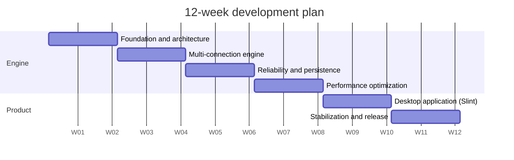

### Weeks 1–2: Foundation and architecture

**Deliverable:** Basic download engine

- Set up Rust workspace.
- Create core crate boundaries.
- Implement download domain models.
- Build HTTP client abstraction.
- Implement single-connection downloading.
- Establish unit testing and logging.

### Weeks 3–4: Multi-connection engine

**Deliverable:** Working segmented downloader

- Implement HTTP capability detection.
- Implement Range Requests.
- Build segment scheduler.
- Implement concurrent workers.
- Implement positioned file writes.
- Add sequential fallback.

### Weeks 5–6: Reliability and persistence

**Deliverable:** Reliable download engine

- Implement pause and cancellation.
- Implement retry management.
- Add SQLite persistence.
- Implement resume functionality.
- Add ETag and Last-Modified validation.
- Build crash recovery tests.

### Weeks 7–8: Performance optimization

**Deliverable:** Benchmarked engine

- Build controlled benchmark server.
- Compare connection counts.
- Optimize disk writing.
- Implement adaptive concurrency.
- Profile CPU and memory.
- Benchmark against aria2 and IDM.

### Weeks 9–10: Desktop application

**Deliverable:** Functional Windows application

- Build Slint interface.
- Implement download queue.
- Add progress events.
- Implement settings.
- Add Windows notifications.

### Weeks 11–12: Stabilization and release

**Deliverable:** Public MVP release

- Perform Windows 10/11 testing.
- Test network interruptions.
- Fix resource leaks.
- Validate installer and updates.
- Improve error messages.
- Create documentation and release builds.

---

## 15. Future development roadmap

After the initial release, expand the project in this order:

|Version|Major functionality|
|---|---|
|v0.1|Basic HTTP/HTTPS downloads|
|v0.2|Multi-connection downloading|
|v0.3|Pause, resume and crash recovery|
|v0.4|Adaptive concurrency and optimization|
|v0.5|Complete desktop interface|
|v0.6|Browser integration|
|v0.7|Download scheduling and bandwidth control|
|v0.8|FTP/SFTP support|
|v0.9|Advanced download management|
|v1.0|Production-ready IDM competitor|

Browser integration deserves its own architecture:

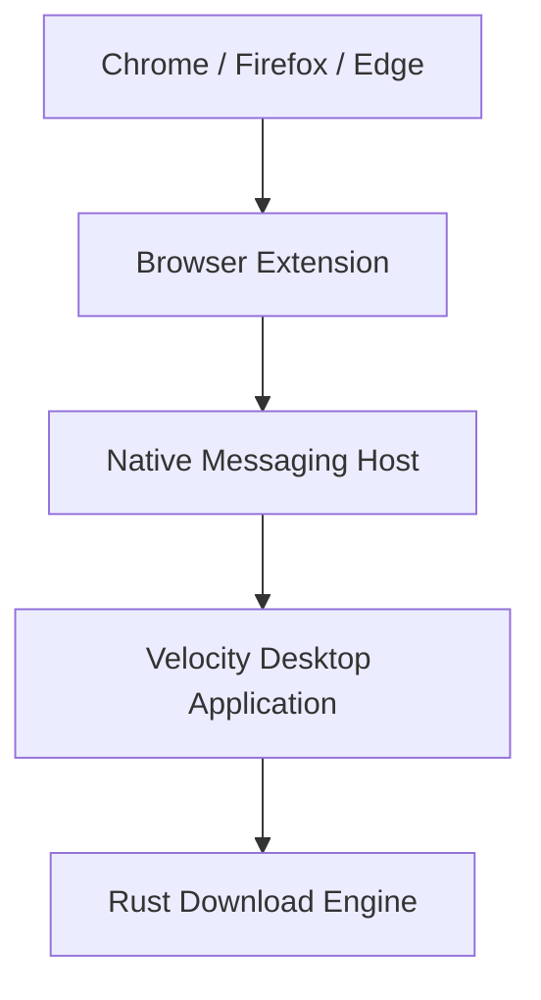

This is preferable to exposing a local HTTP control API without authentication.

---

## 16. Engineering standards

Establish these rules from the beginning.

### Rust coding standards

- Use `cargo fmt` for formatting.
- Use `cargo clippy` for linting.
- Avoid unnecessary `.clone()` operations.
- Prefer explicit error types over generic strings.
- Use structured logging with `tracing`.
- Avoid unbounded channels and task spawning.
- Keep blocking filesystem operations away from Tokio worker threads.
- Use `Arc` only where shared ownership is necessary.
- Avoid holding mutex guards across `.await` points.

### Performance standards

- Every optimization must be benchmarked.
- No unbounded memory buffering.
- No unbounded network concurrency.
- No unnecessary disk synchronization.
- No excessive UI progress events.
- Always compare debug and release behavior appropriately.
- Never sacrifice file integrity for throughput.

### Continuous integration

Set up GitHub Actions with the following pipeline. Use Windows runners for native filesystem and Windows API testing.

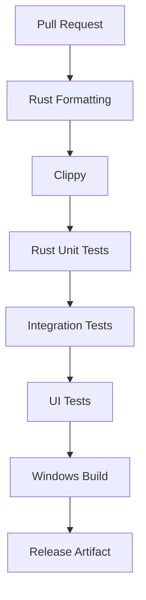

---

## 17. Key architectural decisions

These are the decisions to establish as initial architecture decision records (ADRs).

|Decision|Choice|Reason|
|---|---|---|
|Application architecture|Modular monolith|Simpler desktop deployment|
|Core language|Rust|Performance and memory safety|
|Async runtime|Tokio|Mature async ecosystem|
|HTTP implementation|reqwest|Established HTTP client|
|Segment strategy|Fixed chunks + dynamic scheduling|Load balancing|
|Concurrency|Bounded async workers|Resource control|
|File output|Positioned writes|Parallel disk I/O|
|Persistence|SQLite|Reliable local state|
|UI|Slint|Native desktop integration|
|Benchmarking|Controlled test server|Repeatable results|

---

## 18. The first implementation milestone

Before building everything, focus on a very specific engineering milestone.

### Milestone 01 — High-performance HTTP download engine _(highest priority)_

**Objective:** Download a large HTTP/HTTPS file using multiple connections, correctly reconstruct it, and verify its integrity.

**Acceptance criteria:**

- Accept a download URL.
- Detect server Range support.
- Detect file size.
- Divide the file into segments.
- Download segments concurrently.
- Write segments to correct file offsets.
- Handle failed connections.
- Reconstruct the original file.
- Verify the final file against a trusted checksum.
- Measure throughput, CPU and memory.

> **Definition of success:** The output must be byte-for-byte identical to the original file, with no missing, duplicated or corrupted bytes.

### Recommended initial implementation order

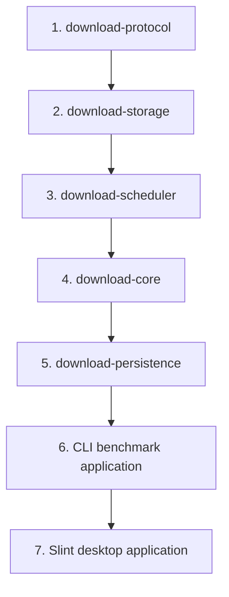

Introduce the persistence interfaces early, even if full crash recovery comes later. This prevents having to redesign the engine's state model.

---

## 19. Recommended technical references

Official resources to use while developing:

- The Rust Programming Language
- Tokio Tutorial
- reqwest Documentation
- Hyper Documentation
- Slint Documentation — [https://docs.slint.dev/latest/docs](https://docs.slint.dev/latest/docs)
- SQLx Documentation
- HTTP Semantics (RFC 9110)
- HTTP/1.1 (RFC 9112)

---

## Final recommendation

Three things to prioritize above everything else:

1. **Download engine correctness:** Range validation, concurrent writes, resume and file integrity.
2. **Measured performance:** Build the benchmarking infrastructure before attempting sophisticated optimizations.
3. **Independent architecture:** Keep the Rust engine usable without Slint so that future interfaces and integrations don't affect its performance.

A fast download manager is not simply a downloader with 32 connections. It is a carefully engineered networking, scheduling, storage and recovery system.

The first major goal should be to build an engine that can reliably saturate an available network connection without wasting CPU or memory. Once that is achieved, the IDM-style desktop features become much easier to build.