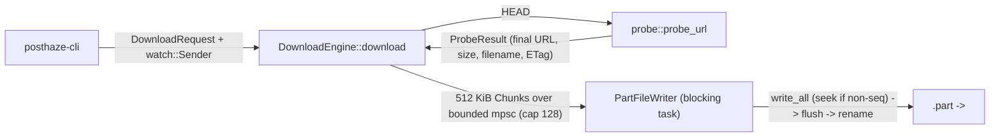

# Ticket 01 — Single-Stream HTTP Download Engine & CLI

Ticket 01 establishes the multi-crate Cargo workspace (`posthaze-engine` + `posthaze-cli`) and delivers an end-to-end single-stream HTTP/HTTPS `Download` pipeline with capability probing, buffered `.part` file I/O, live progress reporting, and benchmark/debug statistics.

## Workspace Layout

- [`Cargo.toml`](../Cargo.toml) — Workspace root (`posthaze-engine`, `posthaze-cli`).
- [`crates/posthaze-engine/`](../crates/posthaze-engine) — Headless HTTP/HTTPS download engine library (zero GUI dependencies).
- [`crates/posthaze-cli/`](../crates/posthaze-cli) — Command-line runner (`posthaze-cli`) consuming `posthaze-engine`.

## Architecture & Data Flow



### 1. Capability `Probing` (`probe.rs`)

`probe_url` sends an HTTP `HEAD` request (following redirects with `User-Agent: posthaze/<version>` and a 15s connect timeout) and extracts:

- `final_url`: Effective URL after redirects.
- `content_length`: Parsed `Content-Length` header (`Option<u64>`).
- `supports_ranges`: Whether `Accept-Ranges: bytes` is advertised.
- `etag` and `last_modified`: Stored on `DownloadOutcome` for future resume validation.
- `suggested_filename`: Resolved in priority order:
  1. `Content-Disposition` RFC 5987 `filename*=UTF-8''...`
  2. `Content-Disposition` `filename="..."`
  3. Percent-decoded terminal URL path segment
  4. `"download.bin"` fallback

All derived filenames are sanitized to strip directory components, replace Windows-illegal/control characters (`< > : " / \ | ? *`) with `_`, strip trailing dots and spaces, and prefix Windows reserved device names (`CON`, `PRN`, `AUX`, `NUL`, `COM1`–`COM9`, `LPT1`–`LPT9`, e.g., `CON.txt` → `_CON.txt`).

### 2. Buffered `.part` File Writer (`writer.rs`)

`PartFileWriter::spawn_with_sync` creates `<final_path>.part`, pre-allocates `Content-Length` bytes via `File::set_len` when known, and runs a dedicated blocking task receiving `WriteChunk { offset, data }` over a bounded `mpsc::channel(128)` for natural memory backpressure. Sequential `Chunk`s skip `seek` calls via a tracked cursor.

During streaming, incoming network frames are coalesced into 512 KiB `BytesMut` buffers (`CHUNK_BUFFER_SIZE`) with pre-reserved capacity before sending to the writer. On completion, `PartFileWriter::finish` closes the channel, calls `file.flush()` (and `file.sync_all()` when `sync_on_complete` is enabled), and atomically renames `.part` to `final_path`.

### 3. Public Engine API (`lib.rs`)

- **`DownloadEngine::new()`** — Builds the shared `reqwest::Client` (`tcp_nodelay(true)`, `15s` connect timeout).
- **`DownloadEngine::download(request, progress_tx)`** — Runs `Probing` → `Active` → `Completed` (or `Failed`), throttling `Active` `ProgressSnapshot` updates to every 50 ms.
- **`DownloadRequest`** — `url`, `output_path`, `output_dir`, `max_workers` (default `8`), `sync_on_complete` (default `false`).
- **`DownloadOutcome`** — `final_path`, `bytes_downloaded`, `content_length`, `supports_ranges`, `workers_used`, `splits_performed`, `retries_performed`, `probe_duration`, `transfer_duration`, `total_duration`, `etag`, `last_modified`, `final_url`, plus `average_bytes_per_sec()`.
- **`EngineError`** — Typed errors (`Http`, `HttpStatus`, `Io`, `Writer`).

## CLI Usage (`posthaze-cli`)

```powershell
cargo run --release -p posthaze-cli -- download "<URL>" [-o <PATH>] [-c <CONNECTIONS>] [--sync-on-complete] [--debug] [--stats-out <PATH>]
```

> **Windows `cmd.exe` note:** Always wrap URLs containing `&` query parameters in double quotes (`"..."`) so `cmd.exe` does not split the command at `&`.

### Flags

| Flag | Default | Description |
|---|---|---|
| `<URL>` | required | HTTP/HTTPS URL to download |
| `-o, --output <PATH>` | auto-resolved | Explicit output file path |
| `-c, --connections <N>` | `8` | Max concurrent `Worker`s (used by multi-`Segment` mode in Ticket 03) |
| `--sync-on-complete` | `false` | Call `File::sync_all()` before renaming `.part` to the final file |
| `--debug` | `false` | Write JSON stats & 200 ms throughput samples to `<file>.stats.json` (or `posthaze-failed.stats.json` on failure) |
| `--stats-out <PATH>` | `<file>.stats.json` | Custom output path for the JSON stats report (implies `--debug`) |

### Output

- **Live stderr ticker (200 ms):** `[State] downloaded/total (pct%) | inst: X MiB/s | avg: Y MiB/s | eta: Zs | workers: N`
- **Completion `Download Summary`:** File path, final URL, byte count, total/probe/transfer times, average & peak speed (`MiB/s` and `Mbps`), `workers_used`, `supports_ranges`, `ETag`, and `Last-Modified`.

## Verification

Run the workspace tests and clippy lints:

```powershell
cargo test --workspace
cargo clippy --workspace --all-targets -- -D warnings
```

Integration tests in [`crates/posthaze-engine/tests/single_stream_download.rs`](../crates/posthaze-engine/tests/single_stream_download.rs) spin up an in-process `TcpListener` mock HTTP server and verify byte-for-byte integrity with `blake3` across:
- Redirects, `Content-Disposition`, `ETag`/`Last-Modified`, `.part` cleanup, and `ProgressSnapshot` completion.
- RFC 5987 `filename*=` precedence and Windows-illegal character sanitization.
- Percent-decoded URL fallback and multi-chunk (> 128 KiB) buffer coalescing.
