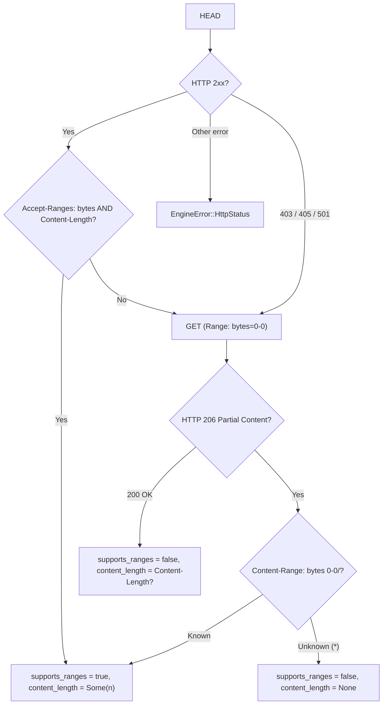

# Ticket 02 — `HEAD`-Blocked Range Probe Fallback & Chunked Handling

Ticket 02 hardens `Probing` in [`crates/posthaze-engine/src/probe.rs`](../crates/posthaze-engine/src/probe.rs) so real-world servers and CDNs that block `HEAD`, strip range metadata, or stream chunked responses are handled accurately.

## Probing Decision Flow

## Key Behaviors

- **`HEAD` fallback statuses:** `403 Forbidden`, `405 Method Not Allowed`, and `501 Not Implemented` automatically fall back to `GET` with `Range: bytes=0-0`.
- **Incomplete `HEAD` metadata:** If `HEAD` returns `200 OK` but omits either `Accept-Ranges: bytes` or `Content-Length`, `Probing` issues `GET` with `Range: bytes=0-0` and merges any missing `ETag`, `Last-Modified`, `Content-Length`, or filename from the `HEAD` response.
- **Multi-`Segment` gating:** `supports_ranges` is set to `true` **only** when both confirmed byte-range support (`Accept-Ranges: bytes` or `206 Partial Content`) and a known total `Content-Length` are present.
- **Chunked / unknown-length responses:** When `Content-Length` is absent, `PartFileWriter` skips `File::set_len` pre-allocation and streams the response in single unbounded `Segment` mode until EOF.

## Verification

[`crates/posthaze-engine/tests/range_probe_fallback.rs`](../crates/posthaze-engine/tests/range_probe_fallback.rs) tests all three paths against an in-process mock HTTP server with BLAKE3 verification:

- `falls_back_to_range_get_when_head_is_blocked` (`HEAD` `405` → `GET Range: bytes=0-0` `206`)
- `falls_back_to_range_get_when_head_omits_range_and_length` (`HEAD` `200` with empty headers → `206`)
- `downloads_chunked_unknown_length_in_single_stream_mode` (`Transfer-Encoding: chunked`, no `Content-Length`)
